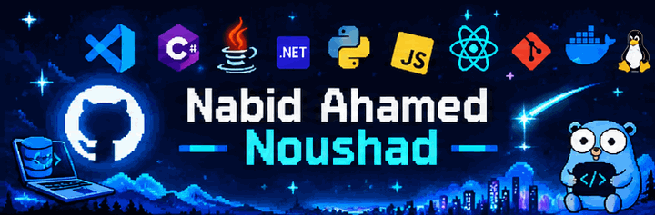
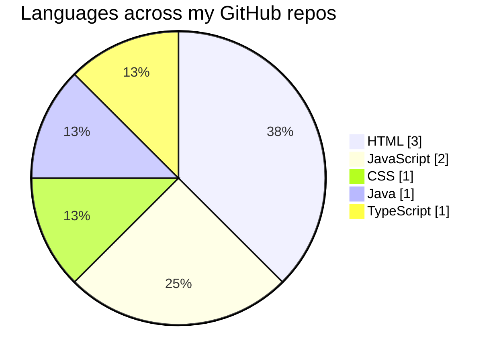

  

## 👋 About Me

I'm a **Jr. Software Engineer at [Databrandix](https://databrandix.com/)**, based in **Dhaka, Bangladesh**.

I build **full-stack web applications**, from React and Next.js interfaces to Node.js and ASP.NET Core backends on PostgreSQL. I care about **clean, readable code**, **thoughtful UI and motion**, and shipping projects that people can actually use.

Right now I'm focused on growing as a full-stack engineer: writing code that's easy to read and change, and using AI tools to build faster without cutting corners.

- Jr. Software Engineer at **Databrandix**
- Full-stack: frontends with **React & Next.js**, backends with **Node.js & ASP.NET Core**
- Working with **PostgreSQL, Supabase & SQL Server**
- Interested in **real-time apps, e-commerce and business systems**
- Exploring **AI-assisted software development**
- Always learning and improving

🔗 **Portfolio:** [nabidahamed.me](https://nabidahamed.me)

## 🌐 Socials:

## 🛠️ Skills & Tech Stack

**Languages**

  
  
  
  
  
  

**Frontend**

  
  
  
  
  

**Frameworks & Libraries**

  
  
  
  
  
  
  
  
  
  

**Backend**

  
  
  
  

**Databases & Storage**

  
  
  
  
  

**Hosting & Tools**

  
  
  
  
  

# 📊 GitHub Stats:

  

<!-- LANGUAGES:START -->

<i>Primary language of my 8 public repositories</i>

<!-- LANGUAGES:END -->

### ✍️ Random Dev Quote

### 🔝 Top Contributed Repo

---

<!-- Proudly created with GPRM ( https://gprm.itsvg.in ) -->

### ⚡ Recent GitHub Activity
 

 
 

<h2 align="center"> Thanks for visiting my Github Profile. </h2> 

 
	

